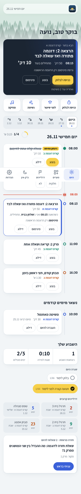
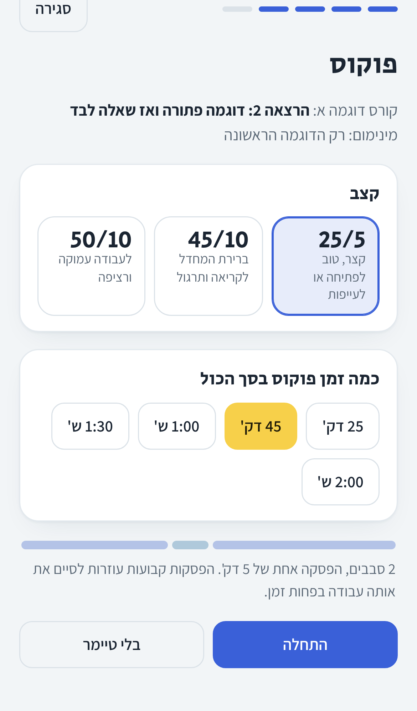
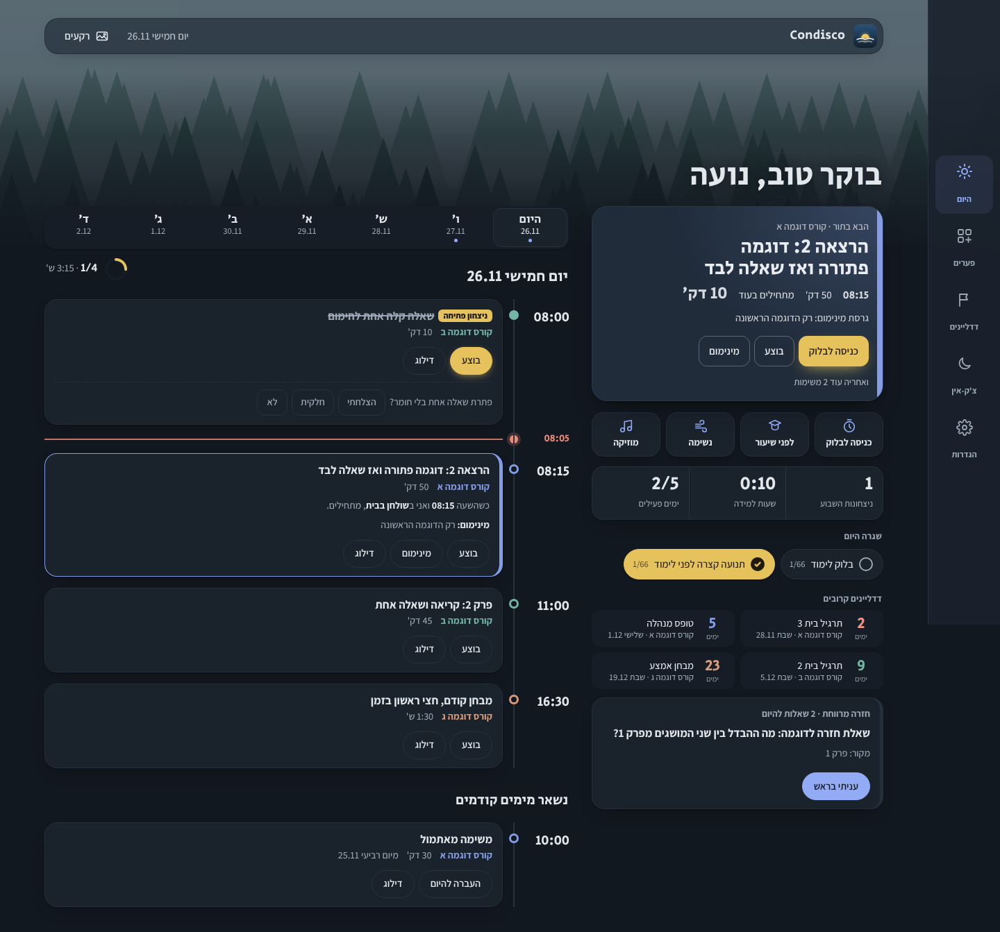

# Condisco

**A study partner for university students that lives inside Claude.**

Condisco (Latin *condiscere*, "to learn together, thoroughly"; said kon-DIS-ko) plans each day from real data, runs focused study sessions that make the student produce first, checks in every evening, and builds backward plans before exams. All study data stays in the student's own private Condisco app on claude.ai. It never invents course content, dates or grades: anything unconfirmed is marked *לא מאומת* (unverified).

<p>
  
  
  
</p>


Screenshots use the fictional sample data from `?mock=1`.

> **סטודנטים:** [מדריך התקנה בעברית](docs/pilot-guide.md), פחות מ-10 דקות, בלי ידע טכני.

## Install (students)

1. You need a paid Claude plan (Pro or higher). In claude.ai, turn on **Settings > Capabilities > Code execution**.
2. Download `condisco-<version>.zip` from the latest [release](../../releases/latest) (or the file you were sent). Do not unzip it.
3. In claude.ai (browser or desktop app): **Customize > Plugins > Add > Upload plugin**, and choose the ZIP.
4. Open a new project, start a chat, and write **להתקין לי Condisco** (or "set up Condisco").
5. Answer four short questions. At the end you see `בדיקת db: עברה ✓` and a link to your private Condisco app. Bookmark it.

Something wrong? See [troubleshooting](docs/pilot-guide.md#אם-משהו-לא-עובד), or write **פידבק על Condisco** in any chat.

## What is in this repository

| Path | What it is |
|---|---|
| [`plugin/`](plugin/) | The Claude plugin `condisco`: five skills (`study-setup`, `study-coach`, `study-session`, `exam-mode`, `study-feedback`) and their evals. |
| [`app/`](app/) | The Condisco web app: a claude.ai artifact with an owner-only database. Hebrew, RTL, mobile first, no build step. |
| [`app/scenes/`](app/scenes/) | 37 procedural SVG landscapes for the desktop idle screen. |
| [`app/audio/`](app/audio/) | Public-domain and CC0 recordings for focus blocks, with [sources and licenses](app/audio/LICENSES.md). |
| [`docs/`](docs/) | Pilot guide, install test, Hebrew style guide, research notes. |
| [`scripts/`](scripts/) | Checks, the browser test runner and the plugin ZIP builder. |
| [`tools/hebrew/`](tools/hebrew/) | The Hebrew copy map and the script that applies it. |

The app has one source, `app/`. The plugin ships a copy of it under `skills/study-setup/assets/app/`, which `npm run build:plugin` creates, so the two cannot drift.

## How it works

1. The student uploads the plugin ZIP to claude.ai and says "להתקין לי Condisco" (or "set up Condisco").
2. `study-setup` asks four short questions, publishes the app as a private artifact with its own database, saves settings and courses, and runs a database self-test.
3. From then on the other skills read and write that database: `study-coach` for the daily plan and evening check-in, `study-session` for a study session (retrieval first, a hint ladder, a closed-book recall question at the end), `exam-mode` for backward exam plans and timed mocks from real past exams.
4. The app shows Today, Gaps, Deadlines, Check-in and Settings, plus a focus timer with breathing, music and a desktop idle screen.

The data model is in [`app/SCHEMA.md`](app/SCHEMA.md).

### AI policy

Learning and explaining with AI is always allowed. Each course has one switch, `aiSolve`, that says whether Claude may solve questions that get submitted for a grade. It starts as `forbidden` until the student confirms it from the syllabus. Typing up the student's own handwritten solutions is always allowed, verbatim and without corrections when solving is forbidden.

## Development

Requirements: Node.js 20 or newer, and `zip` for packaging.

```bash
npm ci
npx playwright install chromium   # once, for the browser tests
npm run serve                     # http://localhost:8811/index.html?mock=1
```

URL options: `?mock=1` fake database with sample data, `?mock=empty` first-run screen, `&now=2026-11-26T08:05:00` fake clock, `#today #gaps #deadlines #checkin #prefs` screens.

| Command | What it does |
|---|---|
| `npm test` | Static checks, unit tests and every browser suite. |
| `npm run check` | Every JS file parses, JSON is valid, the plugin manifest and skills are complete, every scene and audio file in the manifests exists. |
| `npm run test:unit` | Pure tests: focus engine, Leitner boxes, mocks, priority, pruning, migrations, Gaps rules. |
| `npm run test:browser [suite...]` | Playwright suites against the mock app: `smoke today gaps-ui checkin focus timer breath idle sound`. |
| `npm run build:plugin` | Builds `dist/condisco-<version>.zip`, ready to upload. |

CI runs all of this on every push and pull request, and attaches the plugin ZIP to the run.

## Releasing

1. Bump `version` in `plugin/.claude-plugin/plugin.json` and `package.json`, and the version strings in `plugin/skills/study-feedback/SKILL.md`.
2. Add an entry to [`CHANGELOG.md`](CHANGELOG.md).
3. `npm test && npm run build:plugin`, then tag `vX.Y.Z` and attach `dist/condisco-X.Y.Z.zip` to a GitHub release.

## Privacy

This repository holds code and fictional sample data only. Real study data lives in each student's private artifact and is never committed. See [CONTRIBUTING.md](CONTRIBUTING.md#personal-data).

## License

[MIT](LICENSE). Audio recordings keep their own licenses, listed in [`app/audio/LICENSES.md`](app/audio/LICENSES.md).
