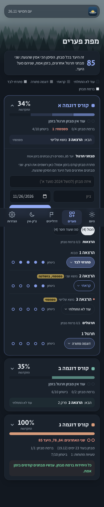

# Condisco

**A study partner for university students that lives inside Claude.**

Condisco (Latin *condiscere*, "to learn together, thoroughly"; said kon-DIS-ko) plans each day from real data, runs focused study sessions that make the student produce first, checks in every evening, and builds backward plans before exams. All study data stays in the student's own private Condisco app on claude.ai. It never invents course content, dates or grades: anything unconfirmed is marked *לא מאומת* (unverified).

<p>
  
  
  
</p>


Screenshots use the fictional sample data from `?mock=1`.

> **סטודנטים:** [מדריך התקנה בעברית](docs/pilot-guide.md), פחות מ-10 דקות, בלי ידע טכני.

## Install (students)

1. You need a paid Claude plan (Pro or higher). In claude.ai, turn on **Settings > Capabilities > Code execution**.
2. In claude.ai (browser or desktop app): **Customize > Plugins > Add > Add marketplace**, enter `Avi-Lezerovich/condisco`, then install **Condisco**. New versions arrive by themselves.
   No marketplace? Download `condisco-<version>.zip` from the latest [release](../../releases/latest) (or the file you were sent), do not unzip it, and use **Customize > Plugins > Add > Upload plugin** instead. An uploaded ZIP does not update.
3. Claude Code users: `/plugin install condisco --marketplace Avi-Lezerovich/condisco`.
4. Open a new project, start a chat, and write **להתקין לי Condisco** (or "set up Condisco").
5. Condisco publishes your private app (`בדיקת db: עברה ✓`), reads your courses and syllabi from Moodle (read only) or from uploaded syllabi, and asks four short questions plus three about how you like to learn. Bookmark the app link.

Full guide: [Hebrew](docs/pilot-guide.md) · [English](docs/install.md). Something wrong? See [troubleshooting](docs/pilot-guide.md#אם-משהו-לא-עובד), or write **פידבק על Condisco** in any chat.

## What is in this repository

| Path | What it is |
|---|---|
| [`plugin/`](plugin/) | The Claude plugin `condisco`: ten skills (`study-setup`, `study-profile`, `study-coach`, `study-session`, `study-teach`, `study-summary`, `exam-mode`, `study-materials`, `study-sync`, `study-feedback`) and their evals. |
| [`kit/`](kit/) | The visual kit: one Hebrew RTL page template and its design rules, copied into `study-summary` and `study-teach` by `npm run sync:shared`. |
| [`app/`](app/) | The Condisco web app: a claude.ai artifact with an owner-only database. Hebrew, RTL, mobile first, no build step. |
| [`app/scenes/`](app/scenes/) | 31 procedural SVG landscapes for the desktop idle screen. |
| [`app/audio/`](app/audio/) | Eight recordings for focus blocks (piano, rain, stream, forest, sea). All are CC0 or public domain except `sea.mp3` (CC BY 3.0, Luftrum). See [sources and licenses](app/audio/LICENSES.md) and [NOTICE](NOTICE.md). |
| [`docs/`](docs/) | Student install guides ([Hebrew](docs/pilot-guide.md), [English](docs/install.md)), Hebrew style guide, research notes. |
| [`scripts/`](scripts/) | Checks, the browser test runner, the plugin ZIP builder and the release publisher. |
| [`.claude-plugin/`](.claude-plugin/) | The marketplace file students add in claude.ai (`Avi-Lezerovich/condisco`). |
| [`tools/hebrew/`](tools/hebrew/) | The Hebrew copy map and the script that applies it. |

The app has one source, `app/`. The plugin ships a copy of it under `skills/study-setup/assets/app/`, which `npm run build:plugin` creates, so the two cannot drift.

## How it works

1. The student uploads the plugin ZIP to claude.ai and says "להתקין לי Condisco" (or "set up Condisco").
2. `study-setup` publishes the app as a private artifact with its own database, runs a database self-test, reads the courses and syllabi from Moodle (read only, through Claude in Chrome) or from uploaded syllabi, and saves them after the student confirms. `study-profile` then asks four short questions and three about how the student likes to learn, and keeps the learner profile (`profile/main`) that every skill reads.
3. From then on the other skills read and write that database: `study-coach` for the daily plan and evening check-in, `study-session` for a study session (retrieval first, a hint ladder, a closed-book recall question at the end), `exam-mode` for backward exam plans and timed mocks from real past exams, `study-materials` for one-line summaries of each unit's Google Drive file, `study-sync` for a read-only "sync now" of Moodle and Piazza, `study-summary` for a summary of a week, unit or topic in the student's preferred form (by default a visual page with diagrams and a recall quiz), and `study-teach` for a short visual lesson on a topic, ending with an explain-back.
4. The app shows Today, Gaps, Deadlines, Check-in and Settings (an Exams tab is built but hidden for now; `?exam=1` shows it), plus a focus timer with breathing, music and a desktop idle screen.

The data model is in [`app/SCHEMA.md`](app/SCHEMA.md).

### AI policy

Learning and explaining with AI is always allowed. Each course has one switch, `aiSolve`, that says whether Claude may solve questions that get submitted for a grade. It starts as `forbidden` until the student confirms it from the syllabus. Typing up the student's own handwritten solutions is always allowed, verbatim and without corrections when solving is forbidden.

## Development

Requirements: Node.js 20 or newer, and `zip` for packaging.

```bash
npm ci
npx playwright install chromium   # once, for the browser tests
npm run serve                     # http://localhost:8811/index.html?mock=1
```

URL options: `?mock=1` fake database with sample data, `?mock=empty` first-run screen, `&now=2026-11-26T08:05:00` fake clock, `#today #gaps #deadlines #checkin #prefs` screens.

| Command | What it does |
|---|---|
| `npm test` | Static checks, unit tests, the kit test and every browser suite. |
| `npm run check` | Every JS file parses, JSON is valid, the plugin manifest and skills are complete, every scene and audio file in the manifests exists. |
| `npm run test:unit` | Pure tests: focus engine, Leitner boxes, mocks, priority, pruning, migrations, Gaps rules. |
| `npm run test:kit` | The visual kit page on a phone and a desktop, light and dark: no horizontal scroll, figures ≤ 480 units with titles, no hard-coded colours, stepper and quiz work. |
| `npm run sync:shared` | Copies the shared skill files (kit, schema, Moodle rules) into every skill that uses them. `npm run check` fails when a copy drifts. |
| `npm run test:browser [suite...]` | Playwright suites against the mock app: `smoke today gaps-ui checkin focus timer breath idle sound exam layout`. |
| `npm run build:plugin` | Builds `dist/condisco-<version>.zip`, ready to upload, and `dist/condisco/` (what the `release` branch holds). |

CI runs all of this on every push and pull request, and attaches the plugin ZIP to the run.

## Releasing

The marketplace file [`.claude-plugin/marketplace.json`](.claude-plugin/marketplace.json) on `main` points at the `release` branch, which holds the **built** plugin (`plugin/` plus the app bundled into `study-setup`). CI writes that branch; never edit it by hand.

1. `node scripts/bump-version.mjs X.Y.Z` (plugin.json, package.json, feedback skill, install guides). **Raise the version on every release**: installed copies update only when the version changes, so a change merged without a new version never reaches students.
2. Add an entry to [`CHANGELOG.md`](CHANGELOG.md) under `## [X.Y.Z]`.
3. Merge to `main`. When the tests pass, CI builds the plugin, validates it (`claude plugin validate`), pushes it to `release` ([`scripts/publish-release.mjs`](scripts/publish-release.mjs)) and creates the GitHub release `vX.Y.Z` with the ZIP and the changelog entry. Pushes that keep the same version publish nothing.

## Privacy

This repository holds code and fictional sample data only. Real study data lives in each student's private artifact and is never committed. See [CONTRIBUTING.md](CONTRIBUTING.md#personal-data).

## License

[MIT](LICENSE). The audio recordings keep their own licenses, listed in [`app/audio/LICENSES.md`](app/audio/LICENSES.md). `sea.mp3` is CC BY 3.0 by Luftrum and needs its credit kept: see [NOTICE.md](NOTICE.md).
